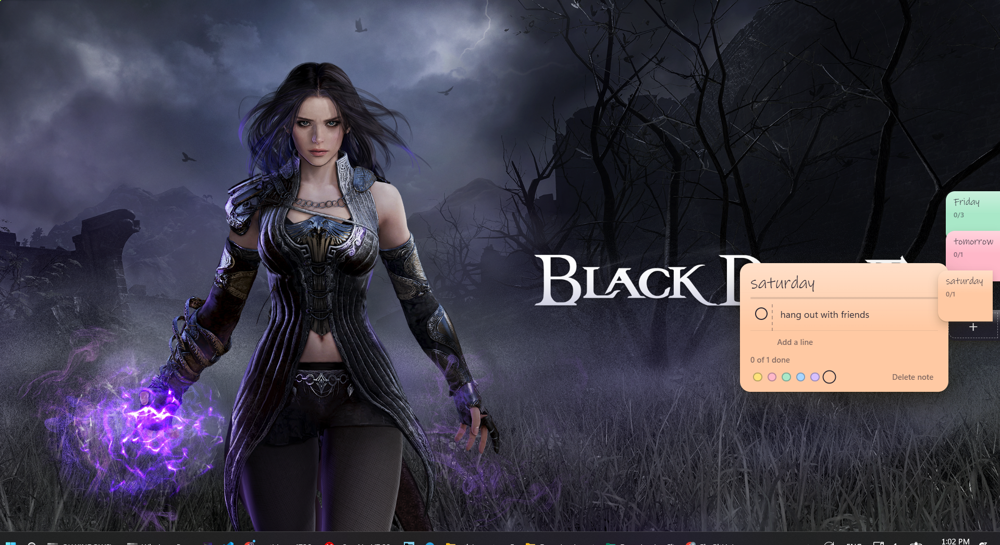

# sticky Notes



Paper sticky notes that live at the edge of your Windows screen.

- A slim pill sits on the screen edge, one coloured dash per note.
- Point at it and the notes fan out as shingled paper tabs.
- Click a tab and the note slides out, ready to edit. Esc or click away tucks it back in.

## Run
```
npm install
npm start
```

## Keys
| Key | Action |
| --- | --- |
| Ctrl+Alt+N | New note (global) |
| Enter | New line |
| Ctrl+Enter | Tick / untick the line |
| Backspace on an empty line | Remove it |
| Esc | Close |

Right-click anywhere on the widget (or the tray icon) for: dock left/right, start with Windows, quit.

## Build an .exe
`npm run dist` locally, or run the **Build Windows app** workflow on GitHub (Actions tab) and download the artifact.

Notes are stored in `%APPDATA%/edge-notes/notes.json`.
